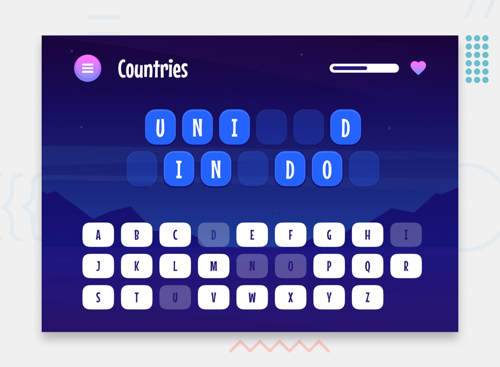

# Hangman

A browser Hangman game built with React and TypeScript. Pick a category, guess a hidden title one letter at a time, and finish it before eight wrong guesses empty the health bar.

**Live site:** [hangman-game-tau-beryl.vercel.app](https://hangman-game-tau-beryl.vercel.app)



## How to play

1. Choose a category: Movies, TV Shows, Countries, Capital Cities, Animals, or Sports.
2. Guess letters with the on-screen keyboard or a physical keyboard. A correct letter fills every matching blank. A wrong letter costs one point of health.
3. Reveal the whole title to win. Eight wrong guesses loses the round.

A title is not dealt again until every title in that category has been played. Pause at any time to continue, start a new round in the same category, pick another category, or return to the menu.

The whole game can be played with a keyboard. Focus moves to each screen heading, and a polite live region announces the category, the shape of the phrase, and the result of each guess.

## Stack

- [React 19](https://react.dev/) for the screens and game UI
- TypeScript, with game rules in a reducer and pure phrase helpers
- [Vite](https://vite.dev/) for development and production builds
- CSS Modules for screen layout
- [Vitest](https://vitest.dev/) for the phrase and reducer tests

## Run it locally

Requires Node.js and [pnpm](https://pnpm.io/).

```bash
pnpm install
pnpm dev
```

| Command | What it does |
| --- | --- |
| `pnpm dev` | Start the dev server |
| `pnpm test` | Run the game-logic tests |
| `pnpm build` | Typecheck and build to `dist` |
| `pnpm preview` | Serve the production build locally |

## Project layout

```text
src/
  components/   screens, dialogs, and styles
  data/         category titles
  game/         reducer, phrase helpers, and tests
  styles/       shared design tokens and global CSS
```

The menu, how-to, category, and play screens share one reducer. Dealing a phrase, recording a guess, and opening the pause, win, or loss dialog are all actions on that state.

## Credits

Interface and category data come from the [Hangman game challenge on Frontend Mentor](https://www.frontendmentor.io/challenges/hangman-game-rsQiSVLGWn). Fonts are Mouse Memoirs, included under the SIL Open Font License (`src/assets/fonts/OFL.txt`).
